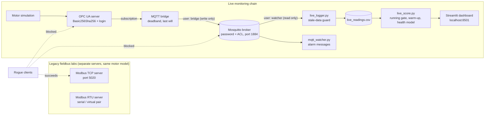

# Industrial Communication Lab

A software-only lab that carries **one simulated industrial motor** through the protocols used in real plants (Modbus TCP, Modbus RTU, OPC UA, MQTT), **attacks and secures each link**, and finally feeds the live data to a **predictive-maintenance health model** with a real-time dashboard.

Everything runs on a laptop with free, open-source tools. No PLC, no serial hardware, no budget.

---

## What this project shows

- How the same motor data looks on four different industrial protocols, down to the bytes (Wireshark decoding, a hand-written CRC-16).
- Why classic Modbus is unsafe on an open network, with a working attack and a device-side defence.
- How a client behaves on a lossy network, and what retries really buy you (and cost you).
- How OPC UA and MQTT add real security: encryption, logins, certificates, per-user access rules.
- How to connect plant data to a machine-learning health model **without fooling it**: running gate, warm-up, baseline, stale-data protection.

---

## Architecture



| Component | Port | Security |
|---|---|---|
| Modbus TCP server | 5020 | none (by design of the protocol) |
| OPC UA server | 4840 | encrypted + signed channel, username/password |
| Mosquitto (locked broker) | 1884 | passwords + topic ACL, localhost only |
| Streamlit dashboard | 8501 | local use |

**The simulated motor** ramps to 1500 rpm, warms up with a thermal lag, and publishes temperature, vibration, current and speed with realistic sensor noise. Faults can be injected at run time: bearing wear (vibration and temperature rise) or overheating (temperature and current rise), with a configurable development time from abrupt (20 s) to gradual (minutes).

---

## The labs

| # | Topic | Files | What to look at |
|---|---|---|---|
| 1 | **Modbus TCP**: register map, server, client, fault injection | `server.py`, `client.py` | Four register tables, integer scaling (temperature x10, vibration x100), Wireshark decoding of function codes 02, 04, 05, 06 |
| 2 | **Modbus RTU**: serial framing and CRC | `crc16.py`, `server_rtu.py`, `client_rtu.py` | A hand-written CRC-16 that matches the library byte for byte (`01 05 00 00 FF 00` gives `8C 3A`) |
| 3 | **OPC UA**: typed, named nodes, browsing, subscriptions | `opcua_server.py`, `opcua_client.py`, `opcua_subscribe.py` | The server describes itself (names, units, access rights); the client is notified of changes instead of polling |
| 4 | **MQTT bridge**: from OPC UA to a broker | `mqtt_bridge.py`, `mqtt_watcher.py`, `live_logger.py` | Deadband, retained messages, last will (`lab/motor/status`), stale-data guard |
| 5 | **Faults and security** | `rogue_client.py`, `proxy.py`, `client_flaky.py`, `opcua_rogue.py`, `gen_certs.py`, `broker/` | Spoofed Modbus writes, a lossy-network proxy, certificates, passwords, ACLs |
| 6 | **Integration**: live health scoring, remaining life and dashboard | `live_score.py`, `live_dashboard.py`, `lab_settings.py` | Uses the health model and RUL methods from the companion project (see below) |

---

## Key results

### Security: attacks and outcomes

| Link | Attack | Result |
|---|---|---|
| Modbus TCP | Rogue client writes `run = False` | **Accepted.** The motor stops; the legitimate client gets no error |
| Modbus TCP | Rogue client sets 3000 rpm | **Accepted**, mitigated by a 2000 rpm limit inside the server |
| OPC UA | Anonymous, no encryption | Refused (`No matching endpoints`) |
| OPC UA | Right user, wrong password, no encryption | Refused (`No matching endpoints`) |
| OPC UA | Encrypted channel, wrong password | Refused (`BadUserAccessDenied`) |
| MQTT | Anonymous publish | `Connection Refused: not authorised` |
| MQTT | Read-only user publishes a forged alarm | **Silently dropped.** The publisher sees no error; only the broker log shows `Denied PUBLISH` |

### Lossy network

A small TCP proxy (`proxy.py`) drops 15% of Modbus messages in each direction and adds 200 ms of delay. In repeated runs of `client_flaky.py`, with `retries=0` between 4 and 10 of 20 polls failed. With `retries=3` none failed, at the cost of a few seconds of extra latency. Retries are not free for commands: if the lost message was the *response*, the request runs twice on the server.

### Health model on live data

- Healthy motor: health index around 1 to 3, well under the alarm level of 5.5.
- After a bearing-wear fault starts, the index crosses the alarm level within about half a minute, long before the server's own fixed vibration alarm (4.5 mm/s) would fire.
- The health score then declines through *Warning*, *Degraded* and *Critical*, and the dashboard shows the maintenance recommendation and an alert history.
- The project's own remaining-life methods (straight-line and parabola extrapolation of the health index) give a live estimate once a fault has been detected. In tests on simulated gradual wear, the estimates were typically within a few readings of the true value near failure and rougher early on.
- If the motor is simply switched off, the dashboard shows "Motor stopped" instead of a false *Critical*.
- If any part of the data chain dies, the dashboard shows a red "no new readings" banner instead of reporting stale values as live.

---

## Quick start

**Requirements:** Windows 10/11, Python 3.11, [Mosquitto](https://mosquitto.org/download/). WSL with `socat` is only needed for the Modbus RTU lab (virtual serial pair).

```powershell
python -m venv .venv
.venv\Scripts\activate
pip install -r requirements.txt
python gen_certs.py          # creates certs/ (never commit this folder)
```

Create the broker users (the passwords used by the scripts are the lab passwords at the top of each file; change them for anything beyond a lab):

```powershell
mkdir broker
mosquitto_passwd -b -c broker\passwd bridge <bridge-password>
mosquitto_passwd -b broker\passwd watcher <watcher-password>
```

`broker/mosquitto-secure.conf`:

```
listener 1884 127.0.0.1
allow_anonymous false
password_file broker/passwd
acl_file broker/acl
```

`broker/acl`:

```
user bridge
topic write lab/motor/#

user watcher
topic read lab/motor/#
```

**Companion project.** `live_score.py` and `live_dashboard.py` reuse the health model (`src/health.py`, `src/rul.py`, `src/config.py`) and the reference runs of the [Industrial-Predictive-Maintenance](https://github.com/ossamabarko-eng/Industrial-Predictive-Maintenance) project. Tell the lab where that project is, in one of two ways:

```powershell
# option 1: an environment variable
$env:IPM_PROJECT = "C:\path\to\Industrial-Predictive-Maintenance"
```

```python
# option 2: a file called lab_settings_local.py next to lab_settings.py (git-ignored)
from pathlib import Path
PROJECT = Path(r"C:\path\to\Industrial-Predictive-Maintenance")
```

If neither is set, the lab looks for a folder called `Industrial-Predictive-Maintenance` next to the lab folder.

Run `python run_pipeline.py` once inside the companion project first. It creates the 12 simulated reference motors in `data/runs`, which the live scorer needs to measure the failure level.

### Run the full live demo (about 8 minutes)

Use one terminal per line, in this order, and wait for each to confirm before starting the next:

| # | Command | Confirms with |
|---|---|---|
| 1 | `mosquitto -c broker\mosquitto-secure.conf -v` | `mosquitto version ... running` |
| 2 | `python opcua_server.py` | `OPC UA server running at ...` |
| 3 | `python mqtt_bridge.py` | `Bridge running: OPC UA -> MQTT` |
| 4 | `python opcua_client.py` | `Commanded: run at 1500 rpm, healthy...` (starts the clock) |
| 5 | `python live_logger.py` | `Logger connected, reason: Success` |
| 6 | `python live_score.py` | `Failure level from N reference runs: ...` |
| 7 | `streamlit run live_dashboard.py` | a browser tab opens |

What happens, counted from step 4:

| Time | Dashboard |
|---|---|
| 0 to 90 s | "Motor warming up" (readings not scored) |
| 90 to 270 s | "Collecting the healthy baseline", then *Healthy* |
| about 290 s | Wear fault injected (`FAULT_AT` in `opcua_client.py`) |
| 315 to 420 s | Fault detected, then *Warning*, *Degraded*, *Critical* |
| 480 s | The client stops the motor: "Motor stopped" notice |

`live_score.py` has two modes, set by `MODE` at the top of the file:

- `demo`: short windows (smoothing window 10, baseline readings 60 to 180) so the whole story fits in a few minutes. The remaining-life settings are scaled down too (trend history 60 readings, estimates start 30 readings after detection).
- `full`: the companion project's exact configuration, with 8+ minutes of healthy running first. Set `FAULT_AT = 500`, `FAULT_RAMP = 300` and `SECONDS = 720` in `opcua_client.py`, so the fault does not land inside the baseline and the wear is slow enough for the project's remaining-life settings (150-reading history, 100 readings after detection) to produce estimates before failure.

---

## Design notes and lessons learned

1. **Modbus has no concept of who is sending.** A forged write is byte-for-byte a normal write. Defences live outside the protocol (segmentation, firewalls, monitoring) and inside the device (limits on setpoints).
2. **TCP hides packet loss, but not message loss.** Gateways, radio links and serial noise show up as timeouts. Retries mask them but can run a command twice.
3. **OPC UA is typed.** Writing an integer into a floating-point node is refused, where Modbus would accept any 16-bit value.
4. **Report-by-exception saves bandwidth and loses detail.** A deadband that suits a dashboard can erase the noise a statistical model needs. The bridge deadband is deliberately tiny for that reason.
5. **MQTT fails quietly.** A denied publish gives the sender no error. Last will and retained messages are how subscribers tell "quiet" from "dead".
6. **A locked door next to an open one protects nothing.** The default open broker service had to be stopped, not just bypassed.
7. **Sample-and-hold hides dead sources.** A logger that repeats the last value forever makes a failed chain look healthy, so the logger refuses to write rows when no fresh message has arrived.
8. **A health model needs the right context.**
   - A stopped motor looks like a disaster to a model trained on running motors, so scoring is gated on speed.
   - The warm-up must not leak into the baseline.
   - The failure level must be measured with the same smoothing window as the live scoring, because the health index grows with window length.
   - A simulator with perfectly steady channels makes the covariance matrix singular. Sensors need realistic noise.
9. **Settings tuned on slow data need re-timing for a fast demo.** With the project's defaults, a motor that fails 82 readings after detection never gets a remaining-life estimate, because the method waits 100 readings and then fits 150 readings of history. Scaling those two numbers down (and measuring the failure level with the same window) fixed it.

---

## Limitations

- Everything is simulated. No real PLC, motor or sensor was used, and the health model has not been validated on real equipment.
- Modbus RTU was tested over a virtual serial pair created with `socat` in WSL. The Windows `com0com` driver could not be loaded (unsigned driver, error Code 52).
- Credentials are in the source code for convenience. Real systems use a secret store.
- The certificates are self-signed and the OPC UA server accepts any client certificate, so the password is the real protection. A production setup keeps a trust list.
- The failure limit (smoothed vibration of 3.5 mm/s) is a placeholder for a real engineering limit.
- Remaining-life estimates are simple trend extrapolations: rough early on, and a guide rather than a guarantee.

---

## Repository layout

```
broker/               mosquitto-secure.conf, acl   (passwd is generated, not committed)
certs/                generated by gen_certs.py    (not committed)
server.py, client.py                 Lab 1  Modbus TCP
crc16.py, server_rtu.py, client_rtu.py   Lab 2  Modbus RTU
opcua_server.py, opcua_client.py, opcua_subscribe.py   Lab 3  OPC UA
mqtt_bridge.py, mqtt_watcher.py, live_logger.py        Lab 4  MQTT
rogue_client.py, proxy.py, client_flaky.py, opcua_rogue.py, gen_certs.py   Lab 5  faults and security
live_score.py, live_dashboard.py     Lab 6  live scoring, remaining life and dashboard
lab_settings.py                      shared settings (lab_settings_local.py holds your own paths, not committed)
LICENSE, requirements.txt, .gitignore
```

---

## Roadmap

- Per-component certificates and an OPC UA trust list.
- TLS on the MQTT broker.
- Containerized setup (broker, server, bridge, dashboard) for one-command start.

---

## License and author

MIT License, see [LICENSE](LICENSE).

Author: Ossama Barko